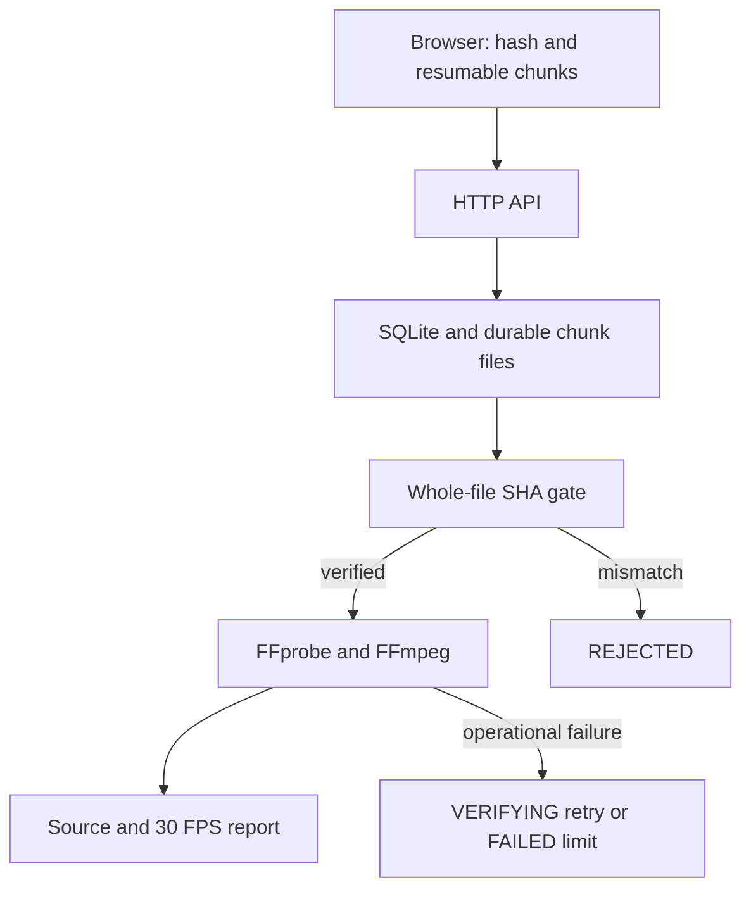

# FrameSure 2.0.0

Reliable video upload and explainable frame-integrity analysis for the IIT (BHU) Confluentia 2026 challenge. A browser uploads a 30-second video in durable 256 KiB chunks. The backend checks every chunk and whole-file SHA-256 before decoding, preserves source timestamps and produces a separate 30 FPS sampling timeline.

**Release status:** locally validated review candidate. 46 Python tests and seven frontend behavior checks pass. Five isolated proxy scenarios and four full HTTP/video benchmark trials pass. A user-completed browser session was observed and its downloaded report checked; the remaining automated browser scenarios are BLOCKED by this environment. Physical network tests and GitHub publication are pending. See docs/TESTING_REPORT.md.

## Install and run (macOS / Linux)

Requirements: Python 3.10+, FFmpeg and FFprobe on PATH, and a local POSIX filesystem. The application requires no third-party Python runtime packages. On macOS, install FFmpeg with `brew install ffmpeg`; on Ubuntu use your package manager's ffmpeg package. Windows is unsupported because this prototype uses POSIX flock.

```bash
python3 -m scripts.preflight
python3 -m backend.api --host 127.0.0.1 --port 8877 --data-dir runtime-data
```

Open http://127.0.0.1:8877. Select samples/valid_30s_30fps.mp4 and click Start verified upload. Emulator percentages control synthetic application-level delay, throttling and request failure; they do not measure radio strength. Use **Emulate 5s outage** while uploading. ACK payload rate measures successfully acknowledged payload divided by elapsed run time, excludes failed attempts, and can include acknowledged replays. Progress counts only acknowledged chunk bytes.

After refresh, reselect the exact same file. Its SHA must match before the client adopts a saved session. A previously completed session may be restored instead of creating another upload. For a fresh independent browser experiment use a fresh browser profile/context; do not delete server data from an active demo.

## Processing timeout and recovery

An invalid/corrupt video is REJECTED. A missing tool, subprocess timeout, OS execution error or signal-terminated decoder is an operational failure: verified bytes and all chunks remain available in VERIFYING. Click **Retry processing**. Finalization is serialized per session; an already completed report is reused without re-decoding. Each complete-data finalize attempt consumes one persisted attempt; after three unsuccessful attempts the session becomes FAILED, with `video_valid=null` and a clear operational error. This does not assert corrupted video. Data remains until configured cleanup. Restore resources and start a new session after the terminal retry budget is exhausted.

The database adds processing_attempts on upgrade; existing sessions retain their data. Byte corruption after a retry clears transfer_verified before rejection. The report download is disabled when a new processing attempt starts and on every new file selection.

## Verification commands

```bash
python3 -m scripts.validate
node tests/frontend_regressions.mjs
python3 -m scripts.network_test
python3 -m scripts.benchmark --out evidence/full_video_benchmark.json
python3 -m scripts.capture_reports
python3 -m compileall -q backend scripts tests
```

For real browser scenarios, install optional dependencies and a Playwright browser:

```bash
python3 -m pip install -r requirements-browser.txt
python3 -m playwright install chromium
python3 tests/browser_e2e.py
```

The browser runner uses `set_input_files()` on the real hidden file input, not the OS dialog. It tests normal upload/download, outage, refresh/reselect, invalid input, timeout/retry and duplicate finalization. Exit 2 means BLOCKED, not passed. Optional FRAMESURE_BROWSER_EXECUTABLE selects an installed Chromium executable. Current local launch fails with SIGABRT/permission diagnostics; no security permissions were weakened. Hosted CI includes a browser job but has not run in this session.

Optional PDF regeneration:

```bash
python3 -m pip install -r requirements-docs.txt
python3 -m scripts.create_submission_pdf
```

## Architecture



Upload state and chunk metadata live in SQLite. Each piece is SHA-checked, written through an atomic fsync/rename and acknowledged after the database commits. Per-session POSIX flock serializes PUT/finalize/cleanup. Whole-file assembly rechecks stored pieces. HTTP responses close connections to avoid unread-body reuse. Duplicate lengths and Transfer-Encoding are rejected on body-reading routes.

## API and layout

- POST /api/uploads: filename, byte size (1..100 MiB), lowercase SHA-256.
- PUT /api/uploads/{id}/chunks/{index}: raw bytes plus X-Chunk-SHA256; same content is idempotent.
- GET /api/uploads/{id}: authoritative acknowledged chunks, status and processing attempts.
- POST /api/uploads/{id}/pause and /finalize: pause or serialize byte verification/processing.
- GET /api/uploads/{id}/report: completed, rejected or terminal operational-failure report.
- GET /api/health: basic HTTP health, not proof that decoder tools are installed; use preflight.

backend/ contains HTTP, storage and video analysis. frontend/ contains the existing dashboard. tests/ contains 46 Python cases, JavaScript behavior checks and the optional Playwright suite. scripts/ provides preflight, validation, benchmarks, isolated proxy tests, sample/report/PDF generation and cleanup. docs/ contains architecture, traceability, audits, browser/network procedures and publication instructions. evidence/ contains current results; baseline Git history and the previous release retain historical evidence.

## Evidence and limits

The baseline commit is 416cfbfc6430533cce724281c1ec233a2c519562. Its 67-file ZIP manifest and 36-test baseline were rechecked before changes. The original release remains untouched. Current evidence labels browser-observed completion separately from automated browser tests that could not launch. One 1,386,829-byte benchmark fixture with one socket cutoff is not a statistical reliability study.

SHA equality proves equality to client-declared bytes, not what a camera captured. Source timestamp gaps and repeated luma hashes are heuristic warnings; a static scene or VFR encoding can explain them. 30 FPS resampling may duplicate or omit frames. No camera-loss precision/recall claim is made.

This remains a localhost prototype: no authentication, TLS, global disk quota, decoder sandbox or asynchronous worker queue. CPU/memory exhaustion, mobile/Safari, physical packet loss, Wi-Fi/mobile handoff and broad codec/VFR coverage are not validated. Cleanup retains tiny lock files to avoid inode races; reclaim them only while the server is stopped. `python3 -m scripts.cleanup --data-dir runtime-data --age-hours 24` performs explicit session cleanup.

## Publication and submission

Public repository: **https://github.com/Priyanshu456574/FrameSure-Confluentia-2026**. Publication uses the existing Git credential helper. See the repository Actions tab for current CI results; no hosted CI pass is asserted in this document. This public snapshot is derived from reviewed release commit b376852173cec9127dfecbaa35c655eae6183264. The preserved local bundle retains the complete historical record; older machine-specific diagnostic history is excluded from public Git history. See docs/GITHUB_SETUP.md. The official PS PDF is excluded because redistribution permission is unknown. No license or contributor identity is invented.

The stated deadline was 15 November 2026, 11:59 PM IST. Late acceptance is not assumed. docs/SUBMISSION_EMAIL.md requests permission to submit; no email has been sent. The versioned ZIP, PDF, Git bundle and outer SHA manifest are the review deliverables.

The included submission PDF and historical release notes record their packaging-time publication checkpoint. This README and the live repository give the current sharing status.
