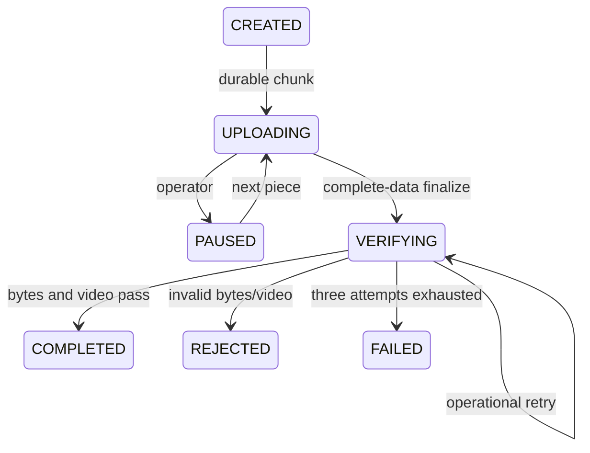

# Architecture and recovery

The existing browser -> Python HTTP -> SQLite/POSIX chunks -> whole SHA gate -> FFprobe/FFmpeg -> JSON architecture is preserved. See README.md for the diagram and runnable commands.

## State machine

The per-session flock is held through assembly and analysis. Concurrent duplicate finalization cannot generate parallel reports. COMPLETED/FAILED finalization is idempotent. Invalid-video REJECTED remains terminal. A real subprocess timeout does not imply invalid video: VideoProcessingError is caught as recoverable, preserves the final file/chunks and returns HTTP 503. Before exhaustion no final report is available; status provides the retry reason. On the third failed attempt FAILED produces an operational-failure report with video_valid=null. The counter survives restart and includes complete-data finalize attempts that are interrupted during assembly. A crash consuming attempt three is detected on the next finalize and converted to FAILED.

SQLite migration adds processing_attempts with default zero under an immediate transaction. Chunk files use temporary files, fsync, atomic rename and directory fsync; SQLite commits acknowledgments afterward. Assembly rehashes every stored piece before invoking tools. If a piece becomes corrupt after an earlier verified timeout, terminal rejection clears the old verification flag.

## Evidence pipeline

FFprobe selects the video stream and checks duration/dimensions. FFmpeg decodes with explicit error detection. Source best-effort timestamps are inspected before a separate fps=30 timeline. Large timestamp gaps and repeated 32x32 luma hashes are heuristic; fingerprint output uses passthrough frame timing. Reports keep transfer.complete, processing.video_valid, source observations and target samples separate.

## Client behavior

The selected file is locked during active workers. Versioned hash callbacks cannot overwrite a newer selection. All workers in a batch settle before another run is enabled. Each durable chunk ACK updates progress; transient request failures use bounded exponential retries. An application-layer outage delays new sends; already in-flight requests can finish. Refresh requires same-file reselection; a server session is adopted only after hash/size match. Retry processing is explicit and bounded; report download is cleared at new file selection and at each attempt.

## Boundaries

Python threads and SQLite suit a single laptop demonstration. Synchronous processing can hold HTTP requests open; use asynchronous jobs and distributed storage/locks before scale-out. POSIX filesystem durability is assumed. No auth, TLS, global quotas or decoder isolation is provided. External dependency timeouts bound duration but do not create a resource sandbox. See SECURITY_LIMITATIONS.md.
